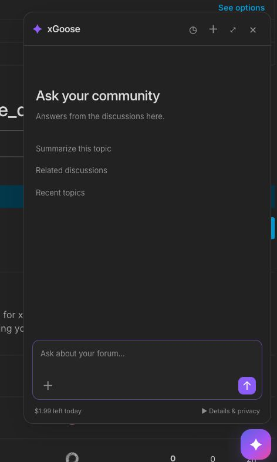
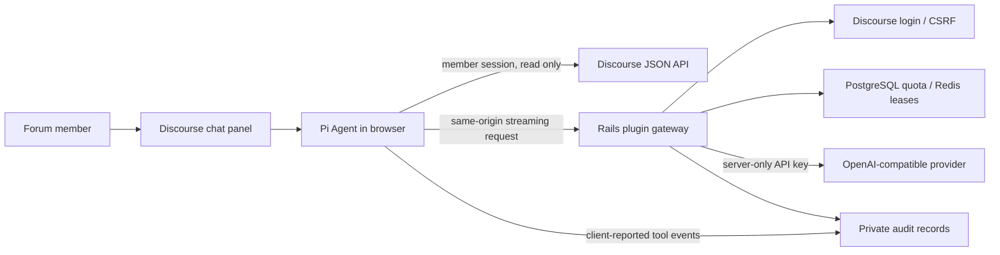

# xGoose for Discourse

**An AI research assistant that lives inside your forum.** Search discussions, read the original posts, and get answers with links to the sources—without installing a browser extension.

[简体中文](README.zh-CN.md) · [Installation](#installation) · [Configuration](#configuration) · [Architecture](#architecture) · [Development](docs/development.md)

> v0.2.0. See [verification](docs/verification.md) for the exact Discourse versions and checks completed, including a live Luna image-and-research workflow. No production forum is deployed by this repository.

## What it does

- A floating chat panel, with streaming answers, readable tool activity, and post citations.
- Searches and reads forum content directly in the member's browser, using their existing Discourse permissions.
- Reads restricted categories that the member can access. Private message tools require the member to enable **Include my private messages**.
- Uses one administrator-configured OpenAI-compatible model. Members never receive the upstream API key.
- Enforces daily dollar budgets (default **$2 per member**), request rates, and concurrency on the server, including for administrators.
- Provides native administrator cost, token, request, and latency charts, per-user usage and budget controls, and readable diagnostic transcripts.
- Attaches up to two images per message for model understanding and forum research, with browser-side resizing.
- Saves account-scoped chat history and images locally in IndexedDB; reopening the panel starts a fresh chat, with explicit history restore.
- Automatically summarizes earlier Pi context as conversations grow, while retaining the full local transcript.
- English and Simplified Chinese interfaces, following the user's Discourse language.

The first version focuses on reading. It does not post replies, execute arbitrary JavaScript, browse other sites, install skills, or automate navigation. Chat stays open while navigating the forum. Closing and reopening the panel or refreshing starts a new chat. Earlier chats, images, and model context can be restored from local history on that browser. History is isolated by forum origin, base path, and signed-in account; it does not sync across devices. Audit logs remain a separate administrator troubleshooting service.



[Image research](docs/screenshots/live-image-demo.jpg) · [Local history](docs/screenshots/history-live.jpg) · [Monitoring dashboard](docs/screenshots/admin-overview.png) · [Readable transcript](docs/screenshots/admin-transcript.png)

## Installation

Install as a standard plugin on a self-hosted Discourse instance. Add the repository to your container's plugin clone hook in `containers/app.yml`:

```yaml
hooks:
  after_code:
    - exec:
        cd: $home/plugins
        cmd:
          - git clone https://github.com/xGoose-dev/discourse-xgoose.git
```

If `after_code` already exists, add the clone command to its existing plugin list. Rebuild the Discourse container with `./launcher rebuild app` from your Discourse Docker directory.

The repository includes the built browser Agent. Installing the plugin does not require a separate Node server, API gateway, database, or a dependency on Discourse AI. PostgreSQL, Redis, and scheduled jobs use your existing Discourse installation.

## Configuration

In **Admin → Settings**, search for `xgoose`:

1. Set `xgoose_api_base_url` to the provider's **HTTPS** API base, such as `https://your-provider.example/v1`. The plugin appends `/chat/completions`.
2. Set the secret `xgoose_api_key` and `xgoose_model`.
3. Choose context, output, daily USD budget, request rate, concurrency, and log retention limits. Set the input, output, cache-read and cache-write USD prices per million tokens to match the configured provider.
4. Enable `xgoose_enabled` and reload the forum.

For **GPT-6 Luna**, use `gpt-6-luna`, enable `xgoose_use_max_completion_tokens`, and enable `xgoose_disable_reasoning`. Luna requires `reasoning_effort: none` for function calls through Chat Completions. These options leave the browser Agent and the provider interface unchanged.

The model must support streaming **OpenAI Chat Completions**, text/image messages, and function tool calls. The upstream should return streaming usage with `stream_options.include_usage`; providers that omit usage are charged conservatively. Responses API, non-streaming mode, and per-member API keys are outside this version's interface.

Defaults are **$2 per user per UTC day**, 2,048 output tokens per call, 20 model requests per user per minute, one concurrent call per user, eight concurrent calls across the site, eight model calls per question, a 120-second timeout, and 90 days of audit retention. Each limit is a site setting except the fixed one-call-per-user concurrency limit.

The context setting uses a conservative UTF-8 byte estimate plus message overhead and output allowance. Long conversations can reach this safety estimate before the provider's real tokenizer limit. At 55% of the configured context estimate, the Pi request hook generates a compact summary, preserving questions, source URLs, image observations, and outstanding research. The full chat remains in local history. Summary calls use the same server budget and per-question call limit. Extremely large single messages can still require a shorter question. Completed calls use upstream input/output usage and reported cache hits with the price snapshot recorded at reservation; interrupted calls or missing usage retain the conservative dollar reservation. Money is stored as integer micro-USD, rounded up once per call. Displayed cost is the plugin estimate under administrator-configured rates, not an invoice from the provider. Repeated retries are never free. Administrators have the same limits as other users.

## Audit logs and privacy

Open **Admin → Plugins → xGoose → Overview**, or `/admin/plugins/discourse-xgoose/overview`, for cost, token, request outcome, and P50/P95 latency charts. Reports default to seven calendar days in the administrator’s timezone; daily budgets reset at 00:00 UTC. The overview refreshes every 30 seconds while visible. Charts distinguish reported usage from conservative charges, and pre-model rejections from upstream failures. Input excludes cache hits in the stacked chart so cached tokens are counted once. The top-ten user table links to individual reports; chart points open logs for that day.

**User usage** searches all forum accounts, including members who have never used the assistant. An administrator can set an individual daily base limit (zero blocks new calls, blank restores the site default) and set today’s total additional dollar budget. Additional budget expires at midnight UTC; only its unspent and unreserved portion can be withdrawn. Each change requires a reason and records the administrator, date, effective day, and before/after amounts. Mutations are locked with request reservations and have idempotency IDs. Lowering a budget does not cancel active calls or refund usage. Members cannot edit budgets or request extensions through the plugin.

**Conversation logs** uses summary-only cursor-paginated lists. Open a session to read its turn-by-turn question, model output, tool results, and context summaries, then expand the original model snapshots if needed. Export JSON for raw requests/events and reconstructed turns, or text for a readable transcript. Missing client events, sequence gaps, missing tool results, partial answers, and interrupted requests are identified explicitly. Tool events and purpose labels are client-reported diagnostics; only server-side usage records drive charges. Older requests have no purpose or first-output measurement and show unknown values rather than invented history. Restricted/private text may appear in these administrator-only records. Moderators and regular members have no access.

Monitoring flags high upstream failure rates (at least five calls and 20% failures in 15 minutes), expired reservations, stale cleanup, incomplete transcripts, and quota rejections. No external metrics service or proactive notifications are required. `/sidekiq/scheduler` exposes the native scheduled-job diagnostics.

The default retention is **90 days** for conversation content, request metrics, usage, rejection records, and budget-change history. Effective personal daily-limit configuration remains until changed. Upgrading changes the previous 30-day default to 90 and preserves other custom settings; previously removed data cannot be restored. Sessions expire based on last activity, with active requests protected. Manually deleting a transcript preserves charged usage and monitoring metrics until their retention deadline, without refunding budget. The legacy `/admin/plugins/xgoose/logs` and session/export URLs remain available.

Content read for an answer and attached images are sent to your configured model provider. Text can appear in administrator logs; image pixels are replaced by SHA-256 and encoded-size metadata in audit snapshots. Image observations in model responses remain in the transcript. Images and full chat content stay in local browser history until the member deletes them or clears site storage. A shared browser profile shares access to its local storage; account scoping is an application boundary, not encryption. The history panel supports individual chat deletion. Refreshing does not erase history.

Content can include restricted posts and opted-in private messages. The panel explains this behavior. Review your provider and forum settings before enabling the feature for a community. API keys, cookies, and authorization headers are excluded from audit records; chat bodies are filtered from normal Rails parameter logs. Existing database backups can retain older audit data according to your backup policy.

## Architecture



The browser uses seven bundled tools: `search_forum`, `search_private_messages`, `read_topic`, `read_posts`, `categories`, `latest_topics`, and `current_topic`. It reads bounded pages with explicit continuation information. Tool results are source material, not instructions.

The server exposes `/xgoose/config`, `/xgoose/sessions`, session-scoped `/chat/completions` and `/events`, and administrator-only log pages. The proxy fixes the upstream URL, model, output budget, and system prompt, validates message shapes and tool names, requires a member session and CSRF token, and rejects cross-origin browser writes. It does not accept a client-supplied upstream URL or API key and does not follow upstream redirects. These controls bound abuse costs; they cannot prevent an authenticated member from scripting their own allowed requests.

## Development

See [development and testing](docs/development.md), [verification](docs/verification.md), and [contributing](CONTRIBUTING.md). Pi Agent and Pi AI are pinned to `1.3.0`; `npm ci && npm run build` regenerates the committed browser bundle. Changes to that bundle should always come from `frontend/` and the lockfile.

This plugin is a focused successor to the browser-side ideas in [xgoose-agent-core](https://github.com/xGoose-dev/xgoose-agent-core) and [xgoose-skills](https://github.com/xGoose-dev/xgoose-skills), with a smaller tool surface designed specifically for Discourse.

## License

New plugin code is licensed under **GPL-2.0-or-later**. See [LICENSE](LICENSE) and [third-party notices](THIRD_PARTY_NOTICES.md). Pi and its dependencies retain their own licenses.
