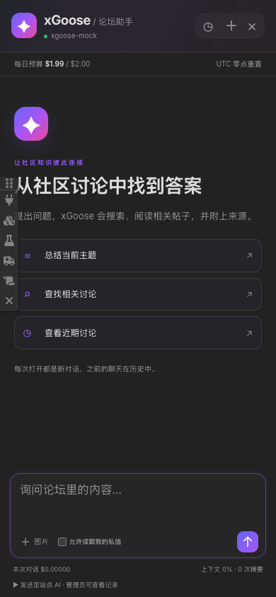

# xGoose for Discourse

**直接安装在论坛里的 AI 搜索与阅读助手。** 用户打开聊天面板，Agent 在浏览器内搜索讨论、阅读原帖，再给出带来源链接的回答。

[English](README.md) · [开发与测试](docs/development.md) · [实际验证记录](docs/verification.md)

当前为首版候选版本；仓库不部署生产论坛，支持版本以实际验证记录为准。

## 功能

- 悬浮入口、流式回答、工具执行详情和帖子引用；桌面侧边面板与手机全屏布局。
- 直接通过用户的论坛登录态调用 Discourse JSON API，权限沿用论坛本身。
- 支持用户有权访问的受限分类；读取私信需用户主动开启“允许读取我的私信”。
- 统一使用管理员配置的 OpenAI 兼容模型，上游密钥仅保存在服务端。
- 每人每日美元预算（默认 **$2**）、请求速率和并发限制，管理员同样受限。
- 管理员可查看和导出模型请求、回答、用量及客户端上报的工具日志。
- 每条消息可添加两张图片，浏览器自动缩放后交由模型理解并搜索相关论坛内容。
- IndexedDB 本地历史按论坛和账号隔离，保存聊天与图片；每次打开面板都是新对话，可主动恢复历史。
- Pi 上下文达到阈值时自动摘要，完整聊天记录仍保留在本地。
- 英文和简体中文，跟随 Discourse 用户语言。

首版专注搜索和阅读，不发帖、不执行任意 JavaScript、不浏览外站、不安装 skills。站内导航保持当前会话，关闭后再次打开或刷新会开启新对话。之前的聊天、图片和模型上下文可在本地历史中恢复，不跨设备同步。后端日志独立用于管理员排障。



## 安装和设置

在自托管 Discourse 的 `containers/app.yml` 中，把下面的命令加入现有插件克隆步骤：

```yaml
hooks:
  after_code:
    - exec:
        cd: $home/plugins
        cmd:
          - git clone https://github.com/xGoose-dev/discourse-xgoose.git
```

从 Discourse Docker 目录运行 `./launcher rebuild app`。仓库已提交浏览器 Agent 构建产物，无需额外的 Node 服务、网关、数据库或 Discourse AI。

在管理员设置中搜索 `xgoose`，设置 HTTPS 上游基础地址（例如 `https://your-provider.example/v1`）、密钥和模型 ID，最后开启 `xgoose_enabled`。模型必须支持流式 OpenAI Chat Completions 和工具调用。暂不支持 Responses API 或用户自带 API；图片理解需要站点模型支持视觉输入。

使用 **GPT-6 Luna** 时，模型设为 `gpt-6-luna`，同时开启 `xgoose_use_max_completion_tokens` 和 `xgoose_disable_reasoning`。Luna 通过 Chat Completions 调用工具时需要 `reasoning_effort: none`。

默认限制：每人每日 **$2** 美元预算（UTC 零点重置），每次输出最多 2,048 token，每人每分钟 20 次调用，每人同时 1 次、全站同时 8 次调用，每个问题最多 8 次模型调用，120 秒超时，日志保留 30 天。除每人同时 1 次的限制外，均可通过站点设置调整。

额度在请求前原子预留，完成后按上游 usage、缓存命中和本次预留时保存的价格结算，以整数微美元存储。管理员分别设置每百万输入、输出、缓存读取与写入 token 的美元价格，应与服务商一致。界面费用是按这些价格计算的估算值，不是服务商账单。上游缺少 usage、请求中断或进程退出时保守计费，避免免费重试。上下文上限按 UTF-8 字节及消息开销保守估计，可能提前于模型实际 tokenizer 上限；上下文达到配置上限估算值的 55% 时，Pi 请求钩子自动总结之前的请求、事实、引用、图片观察和未完成事项；摘要同样计费并占用每问调用次数，完整聊天仍在本地。过大的单条消息仍需缩短。

## 日志与隐私

管理员打开 **`/admin/plugins/xgoose/logs`**，可按用户、时间与状态筛选，查看请求快照和回答、导出 JSON 或文本、删除已完成日志。普通用户和普通版主无权访问。后台定时任务按保留期限清理会话及相关内容。

用于回答的内容与图片会发送给站点模型服务。文本可能进入管理员日志；图片原始像素在审计快照中替换为 SHA-256 与大小元数据，模型对图片的描述仍会保留。完整聊天和图片保存在此浏览器的 IndexedDB 中，直到用户在历史中删除或清理站点存储。账号隔离属于应用层边界，不是加密；共享浏览器配置文件的人可接触其本地存储。内容可能包含受限帖子和用户已允许读取的私信。面板会说明这一行为。数据库备份中的历史数据仍受论坛原有备份策略影响。

服务端记录是用量结算依据；工具日志由客户端上报，只用于排障。缺少事件、工具结果或结束标记，以及模型请求中断时，对话记录会标为不完整。导出的请求快照包含此前的上下文，不会把重复上下文伪装成新消息。

网关固定模型、上游、系统提示和输出上限，验证登录、CSRF、浏览器来源、会话归属、消息和工具白名单；不接受客户端自定义转发地址或密钥，不跟随上游重定向。这些措施限制滥用成本，不能阻止持有合法账号的用户自行封装请求。

## 开发和许可

修改 `frontend/` 后执行 `npm ci && npm run build` 并提交构建产物。测试与架构详见英文说明和开发文档。

新插件代码采用 **GPL-2.0-or-later**。第三方依赖保留各自许可，详见 [第三方声明](THIRD_PARTY_NOTICES.md)。
